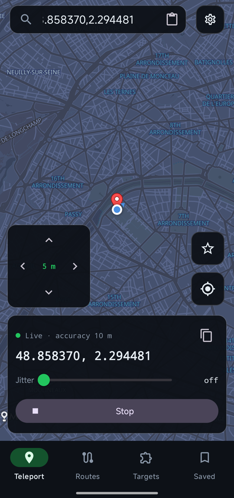
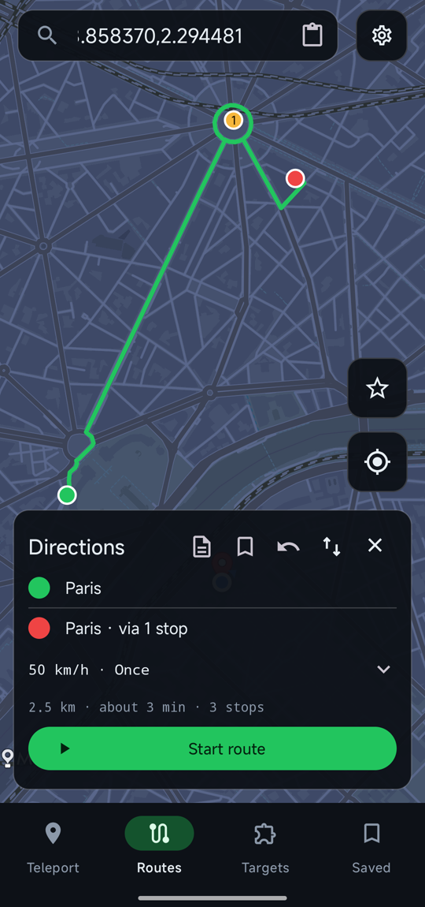
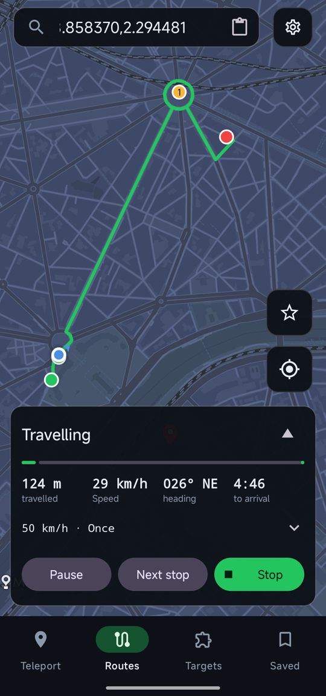
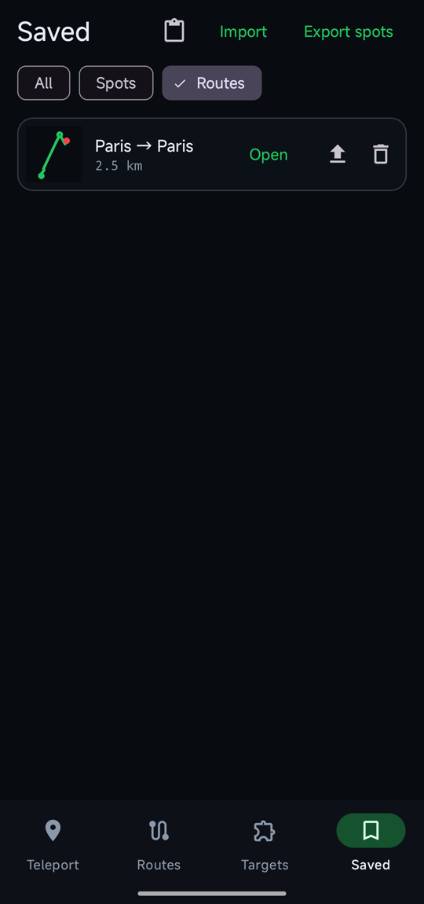

# GPS Setter

An Xposed module that sets your device's location, built on the modern
[libxposed](https://github.com/libxposed/api) API for LSPosed 2.x / Vector.

Fork of [jqssun/android-gps-setter](https://github.com/jqssun/android-gps-setter),
which builds on [Android1500/GpsSetter](https://github.com/Android1500/GpsSetter).

## Screenshots

  
  
  
  

## Features

- System-wide spoofing on Android 12+: every location fix (GPS, network, fused)
  is replaced inside the system server, so apps don't need to be scoped one by one.
- Continuous 1 Hz fix generation, so Google Play services apps follow the set
  location with Google Location Accuracy left on, even indoors with no GPS signal.
- Real location during emergencies: while an emergency call/SMS is active
  (Android 14+), real fixes pass through untouched.
- Start, stop and location changes apply immediately, without a reboot.
- Clean stop: pressing Stop clears the fake location from Android and from
  Google Play services, so apps get your real location back straight away.
- **Teleport**: live status and exact coordinates, paste coordinates from the
  clipboard, a D-pad that nudges the spot by 1, 5 or 10 m, and a jitter slider.
- **Routes**: multi-stop routes along real roads, with numbered via stops; speed
  presets (walk, run, bike, car) or any speed up to 300 km/h, with optional
  variation; play once, in a loop or back and forth; pause, skip to the next
  stop, and slow down for sharp corners. Speed can be changed while playing.
- **Saved**: spots and routes in one list with thumbnails; saved routes keep their
  stops; import or paste GPX and GeoJSON tracks, and export routes as GPX.
- **Targets**: the framework, the processes the module is loaded in, and its
  scope, all managed from the app.
- On-screen joystick to nudge the location live.

## Requirements

- Rooted device with **LSPosed 2.x or Vector** (libxposed API 101+).
  LSPosed 1.x cannot load this module.
- Android 8.1+. System-wide spoofing of live updates needs Android 12+.

## Setup

1. Enable **GPS Setter** in LSPosed and tick **System Framework** in its scope
   (optionally also tick individual apps).
2. Reboot.
3. Open the app, pick a location on the map and tap **Teleport here**.

After updating the module, reboot once so the system hook loads the new version.

## Notes

- Apps protected by Google Play's anti-tamper (those bundling `libpairipcore.so`)
  crash if scoped — don't scope them; rely on the system hook.
- Only enable one location-spoofing module at a time.

Source code & issues: https://github.com/varma322/android-gps-setter
